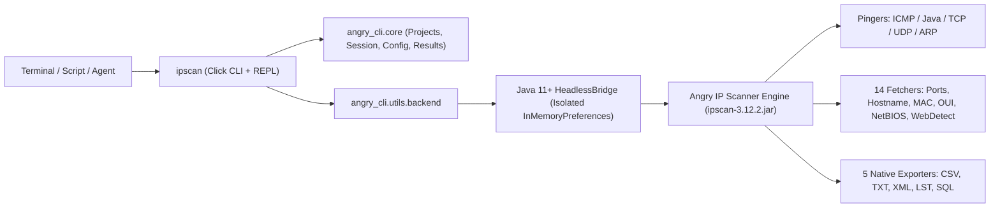

<div align="center">

# angry-cli (`ipscan`)

**Headless command-line interface and interactive REPL powered directly by the real Angry IP Scanner Java engine.**


</div>

---

## Overview

`angry-cli` exposes the full scanning, fetching, and exporting capabilities of [Angry IP Scanner](https://angryip.org/) (`net.azib.ipscan.*`) through a fast, deterministic **`ipscan`** terminal command and stateful interactive REPL — **without requiring an X11 display, SWT GUI window, or modifying global OS preferences**.

Rather than reimplementing network scanning or exporters in Python, `ipscan` invokes Angry IP Scanner's real Java scanning engine (`ComponentRegistry`, `ScannerDispatcherThread`, `PingerRegistry`, `FetcherRegistry`, `ExportProcessor`, and `ExporterRegistry`) through an isolated headless bridge (`org.angrycli.bridge.HeadlessBridge`).

## Key Features

- **Real Angry IP Scanner Engine**: Runs all 6 native pingers (`windows`, `java`, `tcp`, `udp`, `combined`, `arp`), all 14 fetchers (`ip`, `ping`, `ttl`, `packetloss`, `hostname`, `ports`, `filtered-ports`, `mac`, `mac-vendor`, `netbios`, `webDetect`, `httpSender`, `httpProxy`, `comment`), and all 4 feeders (`range`, `random`, `file`, `rescan`).
- **True Headless Execution**: Bootstraps Angry IP Scanner via `ComponentRegistry.init(false)` with an isolated `InMemoryPreferencesFactory` — zero SWT popups on Windows/macOS and zero X11 dependencies on Ubuntu servers.
- **Zero-File Quick Scans**: Run `ipscan quick <target>` to print aligned tables or structured `--json` straight to stdout without writing any files to disk.
- **Stateful Projects & Undo/Redo**: Manage `.json` scan profiles, targets, comments, favorites, and opener templates with locked JSON persistence, auto-save, `--dry-run`, and 50-level undo/redo.
- **Native Exporters**: Export scan results through Angry IP Scanner's real `CSVExporter`, `TXTExporter` (with round-trip re-import), `XMLExporter`, `IPListExporter` (`.lst`), and `SQLExporter`, plus structured JSON.

## Architecture



## Prerequisites

- **Java 11+** (tested on OpenJDK / Temurin / BellSoft Java 11, 15, 17, 21, and 25)
- **Python 3.6+** (tested from Ubuntu 18.04 Python 3.6 + Click 6.7 up to Python 3.14)

> [!NOTE]
> `angry-cli` bundles the compiled Angry IP Scanner 3.12.2 engine JAR (`angry_cli/libs/ipscan-3.12.2.jar`) and pre-compiled Java 11+ headless bridge classes, so it works out of the box on Linux (including older Ubuntu 18.04/20.04 hosts with Java 11/15), Windows, and macOS.

## Quick Start

### One-Line Install from GitHub Release (Wheel)

Install `ipscan` directly without cloning the repo (requires Java 11+ and Python 3.6+):

```bash
pip install --user https://github.com/azkiabenington/angry-cli/releases/download/v1.1.0/angry_cli-1.1.0-py3-none-any.whl
```

*(On Ubuntu 24.04+ / Debian 12+, add `--break-system-packages` if installing outside a virtualenv.)*

### Linux / macOS (From Source — Works With or Without `pip`)

1. **Clone and install** (`install.sh` works even when `pip` is not installed by creating a direct launcher in `~/.local/bin/ipscan` and installing `python3-click` via `apt` if needed; it also links `/usr/local/bin/ipscan` when desktop `/usr/bin/ipscan` is present):

```bash
git clone https://github.com/azkiabenington/angry-cli.git
cd angry-cli
bash install.sh
```

2. **Load `PATH` and refresh shell command cache** in the current shell:

```bash
export PATH="$HOME/.local/bin:$PATH"
hash -r 2>/dev/null || rehash
which ipscan
```

> [!WARNING]
> **If you see `org.eclipse.swt.SWTError: No more handles [gtk_init_check() failed]`**: your system already has the desktop GUI Angry IP Scanner package installed at `/usr/bin/ipscan`, and your shell ran `/usr/bin/ipscan` instead of `angry-cli`. Run `sudo ln -sf "$HOME/.local/bin/ipscan" /usr/local/bin/ipscan && hash -r 2>/dev/null || rehash` (and confirm `which ipscan` resolves to `/usr/local/bin/ipscan` or `~/.local/bin/ipscan`).

3. **Verify and run your first scan**:

```bash
# Verify Java 11+ and the bundled Angry IP Scanner engine
ipscan --version
ipscan backend verify

# Run a quick subnet scan (prints table directly, creates no files)
ipscan quick 192.168.1.0/24 --profile lan-audit --alive-only

# Scan a specific IP range with custom TCP ports
ipscan quick 192.168.1.1-50 --ports 22,80,443,8080 --alive-only

# Output structured JSON to stdout (ideal for scripts & AI agents)
ipscan --json quick 192.168.1.0/24 --alive-only

# Or launch the interactive REPL
ipscan
```

> [!TIP]
> For non-interactive SSH commands (e.g. `ssh user@host ...` or `tsh ssh ...`), call `/home/<user>/.local/bin/ipscan` directly or run via `python3 -m angry_cli quick 192.168.1.0/24 --alive-only`.

### Windows (PowerShell)

1. **Clone and install**:

```powershell
git clone https://github.com/azkiabenington/angry-cli.git
cd angry-cli
pip install --user -e .
```

2. **Verify and run your first scan**:

```powershell
# Verify engine
ipscan --version
ipscan backend verify

# Quick LAN scan (no files generated)
ipscan quick 192.168.1.0/24 --profile lan-audit --alive-only

# Interactive REPL
ipscan
```

> [!NOTE]
> If `ipscan` is not recognized after `pip install --user -e .` on Windows, add your Python user `Scripts` directory (e.g. `%APPDATA%\Python\Python314\Scripts`) to your User `PATH` and open a new terminal, or invoke it with `python -m angry_cli ...`.

## Configuration

| Environment Variable | Default | Description |
|---|---|---|
| `IPSCAN_JAR` | Bundled `angry_cli/libs/ipscan-3.12.2.jar` | Override path to an Angry IP Scanner `.jar` or Windows `ipscan.exe` |
| `IPSCAN_JAVA` | Auto-detected Java 11+ | Explicit path to `java` executable |
| `IPSCAN_JNA_JAR` | Auto-detected from Gradle / system | Optional path to JNA 5.x JAR on Windows for native `WindowsPinger` / `WinMACFetcher` |
| `NO_COLOR` | Unset | Disable ANSI colors in REPL output |

## Usage & Command Reference

### Fast Scan (No Files Created)

```bash
# Scan a CIDR subnet and show only alive hosts
ipscan quick 192.168.1.0/24 --profile lan-audit --alive-only

# Scan an IP range with custom ports
ipscan quick 192.168.1.1-50 --ports 22,80,443,8080 --alive-only

# Fast ping + hostname sweep (no port scan)
ipscan quick 192.168.1.0/24 --profile quick-ping --alive-only

# Structured JSON output to stdout
ipscan --json quick 192.168.1.1-20 --alive-only
```

### Stateful Project Workflow & Native Exports

```bash
# 1. Create a scan project
ipscan project new -o office.json -n "Office LAN" -p lan-audit --cidr 192.168.1.0/24

# 2. Customize pinger, ports, fetchers, and comments (auto-saved)
ipscan --project office.json config set --pinger tcp --ports 22,80,443,3389 --threads 100
ipscan --project office.json fetcher add webDetect
ipscan --project office.json comment set 192.168.1.1 "Core Gateway"

# 3. Run the scan
ipscan --project office.json scan run

# 4. Filter and inspect results
ipscan --json --project office.json result filter --status with_ports --port 22
ipscan --project office.json result stats

# 5. Export via Angry IP Scanner's native exporters
ipscan --project office.json export render report.csv --overwrite
ipscan --project office.json export render report.xml --overwrite
ipscan --project office.json export render open_ports.lst --filter with_ports --overwrite
ipscan --project office.json export render report.sql --overwrite
ipscan --project office.json export render report.txt --overwrite
```

### Interactive REPL

Run `ipscan` with no arguments to enter the interactive stateful REPL:

```bash
ipscan
ipscan --project office.json
```

### Command Groups

| Group | Subcommands | Description |
|---|---|---|
| `quick` | `<target>` | Top-level shortcut for one-shot scans (IP, range, CIDR, or host file) |
| `project` | `new`, `open`, `save`, `info`, `profiles` | Manage scan projects and built-in profiles (`default`, `quick-ping`, `lan-audit`, `web-discovery`, `full-audit`) |
| `target` | `range`, `cidr`, `random`, `file`, `show` | Configure Angry IP Scanner feeders |
| `config` | `show`, `set`, `pingers`, `reset` | Configure `ScannerConfig` (pinger, ports, threads, timeouts) |
| `fetcher` | `list`, `available`, `select`, `add`, `remove`, `move`, `prefs` | Manage all 14 Angry IP Scanner fetchers and preferences |
| `scan` | `run`, `quick`, `rescan`, `status` | Execute real scans and rescans through Angry IP Scanner |
| `result` | `list`, `show`, `filter`, `search`, `sort`, `stats`, `clear` | Inspect, filter, search, and sort stored results |
| `export` | `render`, `presets`, `import-txt` | Export via native CSV/TXT/XML/LST/SQL exporters or JSON, and re-import TXT |
| `comment` | `list`, `set`, `remove` | Manage persistent IP/MAC comments |
| `favorite` | `list`, `add`, `remove`, `use` | Manage saved favorite scan targets |
| `opener` | `list`, `add`, `remove`, `render` | Manage and expand `${fetcher.*}` host opener templates |
| `session` | `status`, `undo`, `redo`, `history` | Manage undo/redo stack and session state |
| `backend` | `info`, `verify`, `native-cli` | Inspect/verify Java engine or invoke original `ipscan` GUI CLI |
| `repl` | *(default)* | Launch interactive REPL |

> [!TIP]
> Pass `--dry-run` with `--project <file>` to preview a one-shot configuration change without auto-saving it to disk.

## Running Tests

```bash
IPSCAN_FORCE_INSTALLED=1 python -m pytest tests/ -v -s
```
